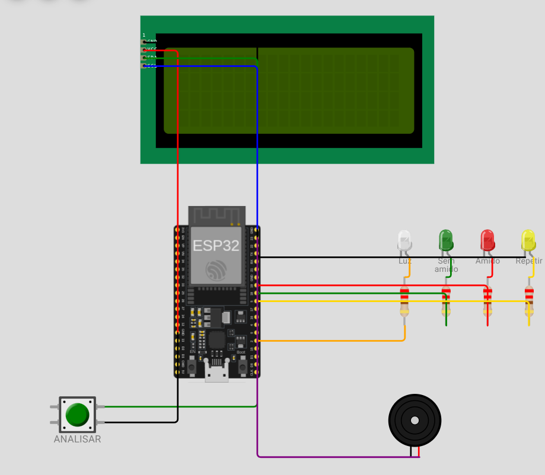

# Protótipo: máquina do teste de iodo

Prova de conceito para a banca. Mostra como seria uma máquina compacta, só para o teste de iodo, com tela LCD: a pessoa pinga o iodo na amostra, aperta ANALISAR e a máquina diz se ainda há amido.

Prova de conceito independente: não altera o frontend, a API nem o banco do MASH. O reconhecimento de cores foi experimentado pelo autor com o celular, mas não foi validado como método de detecção de amido em mostura real. Amostras com corantes representam os resultados; não comprovam presença ou ausência química de amido.

## Esquema conceitual



Imagem fornecida por Haimon em 30/10/2026: montagem de referência no simulador, não fotografia de uma máquina construída nem projeto elétrico homologado. Na demonstração local, a página representa o LCD, o botão, os LEDs e o buzzer; o celular representa a câmera.

Veja [Como o código funciona](docs/funcionamento.md) para as funções, mensagens e limitações.

## Peças

| Arquivo | O que é | Onde roda |
|---|---|---|
| `web/maquina.html` | **Máquina virtual**: LCD 20x4, botão ANALISAR, LED branco de iluminação, LEDs de resultado e bipe | Navegador do notebook (projetor). Sem fila e sem internet |
| `web/index.html` | **Câmera da máquina**: OpenCV.js lê a cor da gota | Navegador do celular |
| `web/comum.js` | Código comum às duas páginas: carrega o OpenCV e faz a troca de mensagens nos dois modos | (usado pelas páginas) |
| `servidor.py` | Servidor local: entrega as páginas por HTTPS e repassa as mensagens. Só Python, sem instalar nada | Notebook |
| `wokwi/` | A mesma máquina num ESP32 simulado (opcional; só online e com fila do Wokwi) | wokwi.com |

Nada disso usa a API ou o banco do MASH.

## Os dois modos

| | Offline (local) | Online |
|---|---|---|
| Quem repassa as mensagens | `servidor.py` no notebook | Broker MQTT público (HiveMQ) |
| Precisa de internet | Não (só uma vez antes, para o `--baixar`) | Sim |
| Máquina | `maquina.html` | `maquina.html` ou o ESP32 do Wokwi |
| Rede | Celular e notebook na mesma rede (roteador ou hotspot, sem internet) | Qualquer rede com internet |

As páginas escolhem o modo sozinhas: abertas pelo `servidor.py`, usam o modo local; abertas de outro lugar (GitHub Pages, por exemplo), usam o online. Dá para forçar um modo no painel "Conexão"/"Configuração". As mensagens são as mesmas nos dois modos, por isso o ESP32 do Wokwi conversa com a mesma página da câmera.

## Fluxo

```
[Botão ANALISAR na máquina]
   │ acende o LED branco, mostra "Analisando..."
   │ publica no canal "pedido"  (local: POST /api/<codigo>/pedido · online: conloq-mash-proto/<codigo>/pedido)
   ▼
[Celular com web/index.html]
   │ captura o quadro da câmera
   │ OpenCV: mede a cor do prato no anel tracejado
   │ OpenCV: separa a gota do fundo (só os pixels do círculo que diferem do prato)
   │ normaliza a cor da gota pela do prato (o prato é o branco de referência)
   │ converte para HSV e aplica a regra
   │ publica no canal "resultado"
   ▼
[Máquina]
   LCD + LED verde "SEM AMIDO", vermelho "AMIDO PRESENTE" ou amarelo "repetir"
```

Se a página não responder em 15 segundos, a máquina mostra "Camera nao respondeu". Se a câmera ou o OpenCV ainda não estiverem prontos, a página avisa e a máquina mostra "CAMERA NAO PRONTA". O botão Analisar da própria página também funciona sozinho, sem a máquina.

Canais (iguais nos dois modos): `pedido` (máquina para câmera), `resultado` (câmera para máquina, no formato `CLASSE;h=..;s=..;v=..;n=..`), `status` e `camera` (avisam "online"/"offline" e ficam guardados para quem entra depois).

### A regra de cor

O LED branco **Luz** representa a iluminação acionada pela máquina durante a captura, não um sensor de luminosidade. O LCD distingue pouca luz (ou anel fora do branco), nenhuma gota e cor não reconhecida. Em leituras reconhecidas mostra `Luz: OK`. Na máquina virtual, a porcentagem é o brilho médio do prato na imagem, normalizado para 0–100; não mede lux nem comprova iluminação adequada para uso científico. Uma leitura inconclusiva não significa ausência de amido.

Verificação das mensagens e do limite de 20 caracteres por linha: `node test-mensagens.cjs`, a partir da raiz deste repositório.

| Condição | Resultado |
|---|---|
| Prato com pouca luz, ou anel fora do branco | Inconclusivo |
| Gota ocupa menos de 3% do círculo | Inconclusivo (nenhuma gota) |
| Brilho relativo da gota abaixo de 0,40 | Amido presente (gota escura) |
| Matiz azul (90 a 140) e saturação ≥ 50 | Amido presente |
| Matiz amarelo/âmbar (8 a 40) e saturação ≥ 50 | Sem amido |
| Qualquer outra cor | Inconclusivo |

A matiz segue o padrão do OpenCV (0 a 180). Os valores são um ponto de partida: calibre com as suas amostras na seção "Calibração" da página. A decisão é uma regra fixa escrita pela equipe; nenhuma IA generativa decide o resultado (#34).

## Amostras para a demonstração

- **Representações para a demonstração:** água com corante amarelo para "sem amido" e água com corante azul-escuro para "com amido". Identifique-as como representações, não medições químicas.
- Este projeto não fornece protocolo de manipulação de reagentes. Uma demonstração química real exige protocolo e supervisão adequados; não ingerir as amostras.

Use um prato ou azulejo **branco** e boa luz. A gota ocupa o círculo menor da tela e o anel tracejado em volta tem que ficar sobre o branco.

## Como rodar

### Offline (recomendado para a banca)

Uma vez, **com internet**, guarde o OpenCV.js e o mqtt.js no projeto:

```bash
python3 servidor.py --baixar     # no Windows: python servidor.py --baixar
```

Na hora, sem internet:

1. Ligue o notebook e o celular na mesma rede: um roteador sem internet ou o hotspot do notebook (ou o do celular) servem.
2. Rode `python3 servidor.py`. Na primeira vez ele cria um certificado próprio em `.cert/` (precisa do `openssl`, que vem no Linux e no Git para Windows) e mostra os endereços:
   ```
   Máquina (notebook/projetor): https://localhost:8443/maquina.html
   Câmera (celular, mesma rede): https://192.168.x.x:8443/
   ```
3. No notebook, abra o endereço da máquina. No celular, o da câmera. O certificado é próprio: o navegador pode exigir exceção ou instalação/confiança explícita no certificado para liberar a câmera. Varia por aparelho; teste antes da apresentação. Como reserva, use a webcam do notebook em `http://localhost:8443/` com `python3 servidor.py --http`.
4. No celular: Ligar câmera. O painel "Conexão" deve mostrar "Modo: local", "conectado" e "Máquina: online"; o LCD da máquina mostra `Camera:OK`.
5. Aperte ANALISAR na máquina (ou a tecla espaço).

O terminal do `servidor.py` mostra cada mensagem trocada, o que ajuda a explicar o fluxo na banca. Se a firewall do notebook bloquear a porta 8443, libere-a para a rede local.

### Online

Sirva a pasta `web/` por HTTPS de qualquer lugar: GitHub Pages, ou `python3 -m http.server 8000` dentro de `web/` com `cloudflared tunnel --url http://localhost:8000`. As páginas entram no modo online e conversam pelo HiveMQ. A máquina pode ser a `maquina.html` ou o ESP32 do Wokwi abaixo, usando o mesmo código (`demo01`).

### Opcional: a máquina num ESP32 simulado (Wokwi, só online)

O plano gratuito do Wokwi tem fila para iniciar a simulação e só sai para a internet pela nuvem dele, por isso não serve para o modo offline.

1. Abra <https://wokwi.com/projects/new/esp32> (pode entrar com a conta do Google ou do GitHub para salvar).
2. Na aba `sketch.ino`, cole o conteúdo de `wokwi/sketch.ino`.
3. Na aba `diagram.json`, cole o conteúdo de `wokwi/diagram.json`.
4. O sketch não depende do gerenciador de bibliotecas: usa o cliente MQTT do ESP-IDF e controla o LCD direto pelo I2C. A compatibilidade depende do ambiente de compilação disponibilizado pelo Wokwi.
5. Clique no play. O LCD mostra "Conectando WiFi..." e depois "aperte ANALISAR", com `Camera:OK` quando o MQTT conectar.
6. Salve o projeto e guarde o link para a apresentação.

Se algum fio aparecer solto depois de colar o `diagram.json`, ligue pelo editor visual: os pinos estão nas constantes no topo do `sketch.ino`.

A página da câmera precisa estar no modo online (aberta pelo GitHub Pages ou pelo túnel), com o mesmo código do `sketch.ino` (`demo01`).

## Roteiro na banca (cerca de 2 minutos)

**Preparação, montagem no local, calibração, o que fazer se algo falhar e o plano B:** [Dia da banca: passo a passo](docs/dia-da-banca.md). Este roteiro é só a fala.

1. Projetar a máquina virtual: "esta é a máquina do teste de iodo".
2. Posicionar as duas amostras coloridas no prato, explicando que representam os estados do teste.
3. Apertar ANALISAR com o celular sobre a gota escura: LED vermelho e "AMIDO PRESENTE".
4. Repetir com a gota amarela: LED verde e "SEM AMIDO, conversão concluída".
5. Fechar com: "isto é a prova de conceito; a câmera embarcada e a integração com o sistema são a próxima etapa".

Antes, calibre no local da apresentação com a "Leitura contínua": a luz da sala muda os números.

## Como seria a máquina de verdade (proposta)

Hipótese de projeto, ainda não validada. Na máquina física a câmera fica dentro dela, no lugar do celular:

| Parte | Opção | Para quê |
|---|---|---|
| Controlador e câmera | ESP32-CAM (OV2640) ou ESP32-S3 com câmera | Captura da foto |
| Tela | LCD 20x4 I2C (como no protótipo) ou TFT 2,8" ILI9341 para mostrar a foto | Resultado e instruções |
| Iluminação | Anel de LED branco | Luz sempre igual, o que torna a leitura de cor confiável |
| Caixa | Câmara escura impressa em 3D, com encaixe para um azulejo branco ou uma placa de toque | Bloqueia a luz da sala e fixa a distância da câmera |
| Interface | Botão ANALISAR e buzzer | Uso com a mão molhada, sem celular |

O ESP32 não roda o OpenCV completo. Há dois caminhos: (a) calcular no próprio ESP32 a cor média da região, que é simples e não precisa de internet; (b) enviar a foto para o Back-End, que roda o OpenCV e grava o resultado no histórico do lote. A escolha fica para o planejamento do próximo semestre.

## Limitações do protótipo

- O broker público é aberto: qualquer pessoa que souber o tópico lê as mensagens. Não envie dados pessoais; para a demonstração basta trocar o código `demo01` por algo único.
- O Wokwi não simula câmera; por isso o celular faz esse papel.
- A regra de cor foi pensada para gota sobre fundo branco e não foi testada com mostura real.
